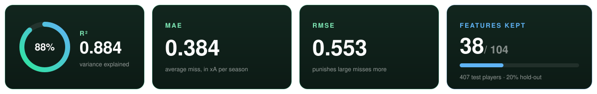
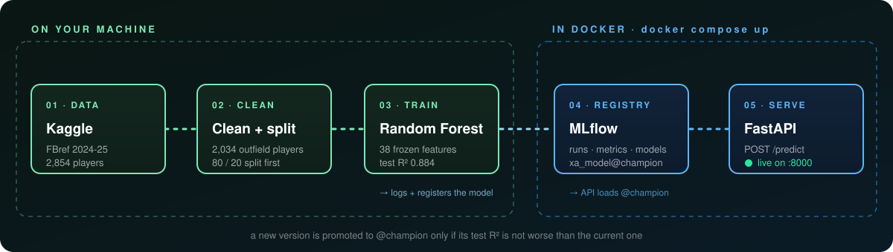
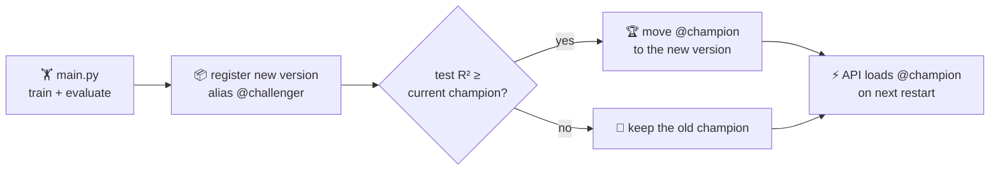

<p align="center">
  
</p>

<p align="center">
  <a href="https://github.com/mostafaelmehi/xa-expected/actions/workflows/ci-cd.yml"></a>
  
  
  
  
  
  
  
</p>

<p align="center">
  <b>How many assists <i>should</i> a player have?</b><br>
  A model that predicts <b>xA (expected assists)</b> for outfield players from their FBref 2024-25 statistics,
  shipped the production way: tracked, registered, versioned and served behind an API.
</p>

<p align="center">
  <a href="#-quick-start">Quick start</a> ·
  <a href="#-how-it-works">How it works</a> ·
  <a href="#-api">API</a> ·
  <a href="#-design-decisions">Design decisions</a> ·
  <a href="#-project-structure">Structure</a>
</p>

---

## 📊 Results

<p align="center">
  
</p>

Scored once on a 20% hold-out set (407 players) that the model never saw during feature selection or tuning.

## ⚙️ How it works

<p align="center">
  
</p>

The **MLflow registry is the only link** between training and serving: training writes a new model version,
the API reads whichever version carries the `@champion` alias.



## 🚀 Quick start

> **Needs:** [uv](https://docs.astral.sh/uv/) and [Docker](https://www.docker.com/products/docker-desktop/). The dataset downloads itself on the first run.

```powershell
# 0. Install dependencies
uv sync

# 1. Start MLflow                       → http://127.0.0.1:5000
docker compose up -d mlflow

# 2. Train, log, register, promote
uv run python -m football.modeling.main

# 3. Start the API                      → http://127.0.0.1:8000/docs
docker compose up -d api
```

Then ask it for a prediction:

<table>
<tr><th>PowerShell</th><th>bash</th></tr>
<tr><td>

```powershell
Invoke-RestMethod `
  -Uri http://127.0.0.1:8000/predict `
  -Method Post -ContentType "application/json" `
  -Body (Get-Content examples/sample_request.json -Raw)
```

</td><td>

```bash
curl -X POST http://127.0.0.1:8000/predict \
  -H "Content-Type: application/json" \
  -d @examples/sample_request.json
```

</td></tr>
</table>

```text
predictions                             model_version
-----------                             -------------
{0.7576104333166832, 4.124874999999992} 1
```

> [!TIP]
> The API needs 10-20 seconds after start to load the model. After retraining, run
> `docker compose restart api` so it picks up the new champion.

## 🔌 API

| Endpoint | What it does |
|---|---|
| `GET /health` | Liveness check |
| `GET /model-info` | Model name, alias, version and the 38 expected features |
| `POST /predict` | xA for one or more players |

<details>
<summary><b>Request and error format</b></summary>

<br>

One object per player, every feature from `/model-info` as a number:

```json
{
  "instances": [
    { "KP": 31.0, "PPA": 14.0, "GCA": 9.0, "xG+/-": -14.0, "...": 0.0 }
  ]
}
```

A missing, unknown or non-numeric feature is rejected with `422`, naming the player and the field:

```json
{"detail": [{"type": "missing", "loc": ["body", "instances", 0, "KP"], "msg": "Field required"}]}
```

The request schema is built from the same feature list the model was trained on, so all 38 fields
show up by name in the interactive docs at `/docs`.

</details>

## 🧠 Design decisions

<details open>
<summary><b>Why it is built this way</b></summary>

<br>

| Decision | Why |
|---|---|
| **Split first, then everything else** | Feature selection and the grid search see the training set only, so the test score is honest. |
| **Frozen features and parameters** | `discover.py` runs selection and tuning once; the result lives in `config.py`. Training is reproducible and takes seconds. |
| **One schema, checked twice** | The API builds its request schema from the frozen list and refuses to start if the loaded model expects different columns. |
| **No preprocessing at serving time** | A Random Forest on 38 raw columns: nothing to re-implement in the API, so no training/serving skew. |
| **Champion / challenger** | A new version is promoted only if it is not worse on the test set. |
| **MLflow behind HTTP, in Docker** | Training uploads artifacts through the server, so no host paths end up in the registry. |
| **Training stays outside Docker** | Only serving has to run identically everywhere. |

</details>

## 🗂️ Project structure

<details>
<summary><b>Show the tree</b></summary>

<br>

```text
football/
├── api.py              FastAPI service, loads the champion model
├── config.py           Every setting: columns to drop, split, frozen features, best params
├── dataset.py          Download from Kaggle and clean
├── features.py         Position features
├── pipeline.py         Load → clean → features → train/test split
└── modeling/
    ├── split.py        Train/test split
    ├── selection.py    Mutual information ranking + forward selection
    ├── train.py        Linear baseline and Random Forest grid search
    ├── evaluate.py     R², MAE, RMSE
    ├── discover.py     One-off: find the features and params to freeze
    └── main.py         Final training, MLflow logging, registration, promotion
tests/                  Data, features, selection, split and API tests
examples/               Example API request
assets/                 README graphics (animated SVG)
Dockerfile              One image for both services
docker-compose.yml      MLflow server + API
```

</details>

## 🛠️ Development

```powershell
uv run pytest tests                           # 22 tests, no MLflow or Docker needed
uv run python -m football.modeling.discover   # redo feature selection + grid search
```

`discover.py` prints two lines to paste into `ModelConfig` (`selected_features`, `rf_best_params`).
Re-run it only when the data or the cleaning rules change.

<details>
<summary><b>Environment variables</b></summary>

<br>

| Variable | Used by | Default |
|---|---|---|
| `RANDOM_STATE` | training | `42` |
| `MIN_MINUTES` | training | `270` |
| `MLFLOW_TRACKING_URI` | training, API | `http://127.0.0.1:5000` (API in Docker: `http://mlflow:5000`) |
| `MODEL_NAME` | API | `xa_model` |
| `MODEL_ALIAS` | API | `champion` |

</details>

## 🧭 Limitations and next steps

- [x] Clean data pipeline with no leakage
- [x] MLflow tracking and registry with champion / challenger
- [x] FastAPI service with a strict request schema
- [x] Docker Compose for MLflow and the API
- [x] Tests for data, features and API
- [ ] CI that runs the tests on every push
- [ ] Orchestration with Prefect
- [ ] More seasons of data (only 2024-25 for now)
- [ ] A small UI for non-programmers

Known limits: inputs are raw FBref totals, so the API is meant to be called by other programs, not typed by hand;
promotion compares every model on the same test set, which becomes optimistic over many comparisons.

## 📚 Data

[Football Players Stats 2024-2025](https://www.kaggle.com/datasets/hubertsidorowicz/football-players-stats-2024-2025) on Kaggle (FBref statistics).

<p align="center"><sub>Built while learning MLOps · animations are plain SVG, no JavaScript</sub></p>
